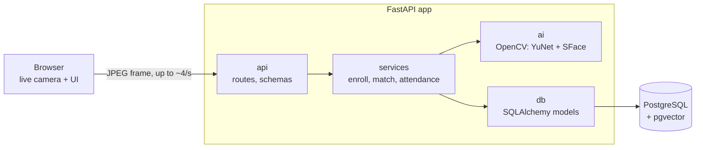

# Face Attendance

A webcam attendance system. Enroll a person with one photo; from then on, anyone who faces the camera is recognized and marked **present** for the day. Enrolled people who haven't been seen are **absent**.

It is a backend + AI portfolio project: a FastAPI service that runs face detection and recognition (OpenCV), stores face embeddings in PostgreSQL with pgvector, and serves a small web UI that shows the live camera.

<!-- Add a demo GIF here:  -->

## Try it

**You need:** Docker Desktop (running), a webcam, an internet connection for the first build, and ports `8000` and `5433` free on your machine.

```bash
git clone <this repository>
cd face-attendance
docker compose up --build
```

That's all: no configuration file is needed. When the output settles, open <http://localhost:8000> (browsers allow the camera on `localhost`, and ask your permission). The first build downloads several hundred MB; later starts take seconds.

<details>
<summary>Troubleshooting</summary>

- **"Cannot connect to the Docker daemon" / "error during connect":** Docker Desktop isn't running. Start it and try again.
- **"port is already allocated" or "address already in use":** another program uses port 8000 or 5433. Stop it, or change the left-hand number in the `ports:` lines of `docker-compose.yml` (for example `"127.0.0.1:8080:8000"`, then open port 8080).
- **The camera stays black or a red message appears:** click the camera icon in the browser's address bar and allow it. The page must be opened as `http://localhost:8000`; the browser blocks the camera on other addresses over plain HTTP. Close other apps that use the camera.
- **Everyone shows as "Unknown":** nobody is enrolled yet. Click **Try Admin**, open **Employees**, and enroll yourself.
- **Start over with empty data:** `docker compose down -v` deletes the containers and the database volume.
- **Use your own database password:** copy `.env.example` to `.env` and edit it *before the first start* (the database keeps the password it was created with; after changing it, run `docker compose down -v` once).

</details>

1. Click **Try Admin** (top right) to reveal the Employees and Attendance tabs.
2. **Employees**: type a name and click *Capture & enroll* (one photo).
3. **Live**: the camera shows your face with a box, your name and a similarity score. The first sighting of the day is recorded.
4. **Attendance**: present and absent lists for any day.

First-time visitors get a welcome card and a **Guide** tab inside the app, and a checklist on the Live tab that ticks off as you go. Interactive API docs: <http://localhost:8000/docs>

## How it works



**Recognition pipeline** (`POST /recognize`):

1. The browser copies a camera frame, shrinks it to 480 px wide, encodes a JPEG and uploads it. It sends the next frame only after the previous answer arrives, so slow responses never build a queue.
2. **YuNet** finds every face and its five landmarks. **SFace** aligns each face and turns it into a 128-number embedding.
3. PostgreSQL finds the closest stored embedding with pgvector (`ORDER BY embedding <=> :query`, cosine distance).
4. If the similarity is at least the threshold (default 0.40), the face is a known employee and the first sighting of the day is recorded. Otherwise it is shown as "Unknown".

**Layers** (each only calls the one below it): `api` &rarr; `services` &rarr; `ai` and `db`. The `ai` layer knows nothing about HTTP or the database: image in, faces out.

### Data model

| Table | Purpose |
|---|---|
| `employees` | `id`, `name`, `created_at` |
| `face_embeddings` | `employee_id` (cascade delete), `model`, `embedding vector(128)` |
| `attendance` | `employee_id` (cascade delete), `day`, `first_seen_at`, `confidence`, **unique `(employee_id, day)`** |

Rules live in the database, not only in the code: no blank names, confidence between -1 and 1, a fixed vector size, and one attendance row per person per day. "Absent" is computed when you ask (an employee with no row that day), not stored.

## Design decisions

| Decision | Why |
|---|---|
| Camera captured **in the browser** | Docker on Windows can't pass a webcam through easily, and the demo needs nothing installed |
| **OpenCV only** (YuNet + SFace) | Measured against InsightFace: 2 Python packages instead of 29, a 37 MB model download, permissive licenses, and fast enough (see results) |
| **pgvector** for matching | One database holds employees, embeddings and attendance; deleting an employee deletes their faces with it; the search is one readable SQL query |
| **Embeddings only**, no photos stored | The system never keeps a picture of anyone |
| `model` column next to every embedding | An embedding only means something for the model that made it; the search only compares embeddings from the same model |
| Idempotent attendance | `INSERT ... ON CONFLICT DO NOTHING ... RETURNING id` on the unique key. Seeing someone 100 times creates one row, even with simultaneous requests |
| Duplicate-face check at enrollment | If recognition would already identify the new face as someone, enrollment is refused (HTTP 409). Otherwise two employees would share one face and one would stay "absent" forever |
| Models loaded once, behind a lock | Loading takes ~0.2 s, so it happens at startup. The detector keeps per-image state, so concurrent requests take turns |
| Plain `def` endpoints | FastAPI runs them in a thread pool, so CPU-heavy face analysis doesn't block the server |
| Migrations with Alembic | The schema is code. The app applies pending migrations on start; the test suite builds its database from the same migrations |

## Measured results

Machine: laptop with an Intel i7-1255U, CPU only, no GPU.

| Measure | Result |
|---|---|
| Accuracy on **LFW** (public benchmark), 1,200 of its 6,000 pairs | **98.75% ± 0.35**, 0 wrong accepts, 1.5% missed matches. The model authors publish 99.60% on the full set. |
| Same-person similarity on my webcam (two people) | mean 0.80 and 0.60 |
| Different-person similarity on my webcam | mean 0.17, highest 0.333 out of 224 pairs |
| Face analysis per frame, live | about 50 ms median (one face) with default threading; 33 ms with one OpenCV thread. The page sends at most ~4 frames per second |
| 1 vCPU / 512 MB container (Docker limits) | about 205 MB RAM with a live camera; one viewer at full speed used ~73% of the CPU, so the page throttles to ~4 frames per second (150 ms measured at 30-45% CPU; 250 ms is lighter still) |
| Docker vs native | no slowdown seen on a blank frame (26-32 ms in the container) |

How much to trust this: the accuracy run used 2 of 10 benchmark folds, and the webcam test used two people in one session (its 224 pairs come from only 30 frames), so these show that the system works, not what its error rate is. The benchmark script was a throwaway and is **not** in this repository. I also tried InsightFace; it was very slow on this machine in two runs for a reason I did not find, and I never finished its accuracy run, so I make **no claim** that OpenCV is more accurate, only that it was accurate enough, faster and lighter here.

## Limitations

- **No anti-spoofing.** A photo of an enrolled person held to the camera will be accepted.
- **No authentication, by design.** "Try Admin" only shows or hides tabs. Every API route is open, including delete. Do not expose this to the internet.
- **A well-known default database password** (`change-me`) is used unless you provide a `.env`. The database is published on `127.0.0.1` only, so just your own machine can reach it, but change it before running this anywhere else.
- **One photo per person, one confident frame marks attendance.** There is no multi-frame confirmation, so a single wrong match marks the wrong person. The 0.40 threshold was chosen from two people and one camera and should be re-tuned for any real use.
- **The quality of the enrollment photo matters**, since it is the only reference.
- Two enrollments submitted at the same instant could both pass the duplicate check (a database constraint cannot express "similar to").
- The app runs migrations on start, which is fine for one instance; several instances would need a separate migration step.
- The Docker image is 657 MB and not optimised.
- The browser UI has no automated tests and was only tried on one machine.

## Run it for development

```bash
copy .env.example .env                    # macOS/Linux: cp. The app and the tests read the database settings from here
docker compose up -d db                   # PostgreSQL + pgvector on localhost:5433
python -m venv .venv
.venv\Scripts\pip install -r requirements-dev.txt     # macOS/Linux: .venv/bin/pip
.venv\Scripts\alembic upgrade head
.venv\Scripts\uvicorn app.main:app --port 8000
```

Tests (need the database container running; they use their own `attendance_test` database, rebuilt from the migrations, and never touch your data):

```bash
.venv\Scripts\python -m pytest
```

### Settings (environment variables or `.env`)

| Name | Default | Meaning |
|---|---|---|
| `POSTGRES_USER`, `POSTGRES_PASSWORD`, `POSTGRES_DB` | `attendance`, `change-me`, `attendance` (set in `docker-compose.yml`; the same values as `.env.example`) | Database credentials. Optional with Docker; needed in `.env` when you run the app or the tests outside Docker |
| `POSTGRES_HOST`, `POSTGRES_PORT` | `127.0.0.1`, `5433` | Where the app finds PostgreSQL (Docker sets `db`, `5432`) |
| `MATCH_THRESHOLD` | `0.40` | Minimum cosine similarity to accept a face |
| `PORT` | `8000` | Port the server listens on inside the container (hosting platforms set it) |
| `TIMEZONE` | local time | Decides when a new attendance day starts, e.g. `Europe/Berlin` |

## API

| Endpoint | Description |
|---|---|
| `GET /health` | Checks the database and the models and reports the current match threshold; 503 if either is down |
| `POST /employees` | Enroll: form fields `name` and `photo`. 409 if the face is already enrolled, 422 if the photo is unusable |
| `GET /employees` | List employees |
| `DELETE /employees/{id}` | Delete an employee and, by cascade, their embeddings and attendance |
| `DELETE /employees` | Delete everyone (the "Clear all data" button) |
| `POST /recognize` | Upload a camera frame (`frame`); returns each face's box, name and similarity, and whether attendance was newly recorded |
| `GET /attendance?day=YYYY-MM-DD` | Present and absent lists (default: today) |

## Project structure

```
app/
  main.py             app creation, models loaded at startup
  config.py           settings (environment, then .env)
  api/                routes and response schemas
  services/           enrollment, matching, attendance report, clock
  ai/face_engine.py   YuNet + SFace through OpenCV
  db/                 SQLAlchemy models and session
  static/             the web UI (plain HTML, CSS, JavaScript)
alembic/              database migrations
models_opencv/        the two ONNX model files
tests/                pytest suite (real PostgreSQL; only the face engine is faked)
Dockerfile, docker-compose.yml
```

## Credits and licenses

- Face detection: **YuNet**, face recognition: **SFace**, both from the [OpenCV Zoo](https://github.com/opencv/opencv_zoo) (YuNet is MIT-licensed, SFace is Apache 2.0).
- Accuracy benchmark: **Labeled Faces in the Wild (LFW)**.
- Vector search: [pgvector](https://github.com/pgvector/pgvector).
